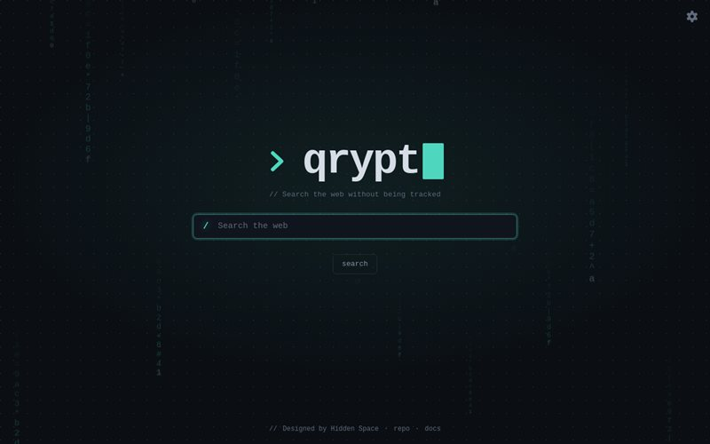
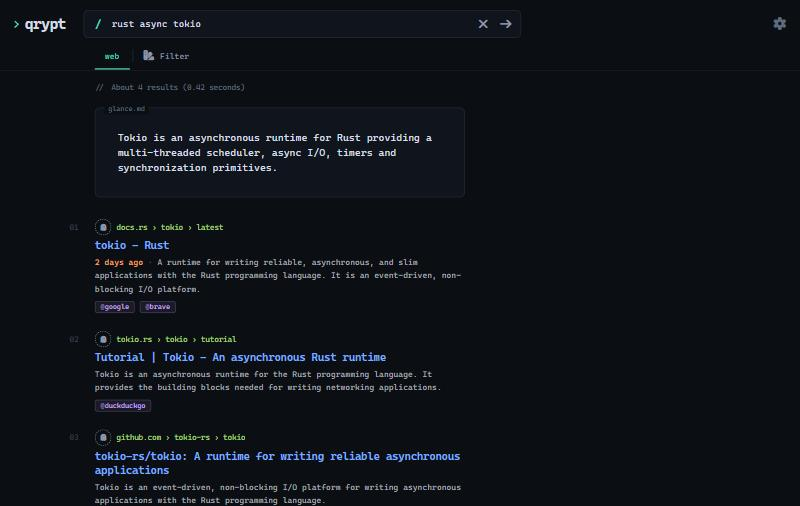
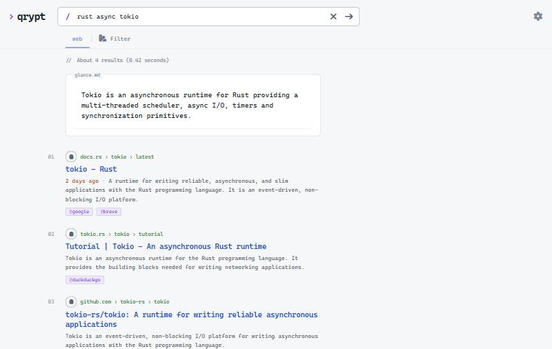

<p align="center">
  
</p>
<p align="center">
  
  
  
  
</p>

<p align="center">
  
  
</p>

# 💻 Qrypt

**Qrypt is a code-focused theme for [degoog](https://github.com/degoog-org/degoog): monospace type, an
editor palette, a terminal prompt and line-numbered results, in light and dark.**

## ⭐ Features

- **🔤 Monospace Everywhere** — Uses the fonts already on the device (JetBrains Mono, Cascadia Code, Fira Code, SF Mono, Consolas…). Nothing is loaded from third parties
- **🎨 Editor Palette** — Titles look like functions, URLs like strings and engines like `@decorators`
- **⌨️ Terminal Prompt** — A prompt logo with a blinking caret, a `/` search prompt and a `// comment` footer
- **🔢 Line-Numbered Results** — An editor-style gutter numbers each result on wide screens
- **📄 At a Glance** — The summary box is framed as `glance.md`
- **✨ Motion** — The logo types itself in, the focused search bar runs a scan along its border and results cascade in. Everything stays still when the device asks for reduced motion
- **🌗 Light and Dark** — Follows degoog's appearance setting
- **🌈 Five Accents** — Mint, Amber, Violet, Cyan and Rose for the prompt, caret, focus ring and active tab
- **🏷️ Qrypt Branding** — Page and tab titles, logo, favicon and the no-JS pages all read **Qrypt**

## 📸 Screenshots

<p align="center">
  
  
  
</p>

## 📦 Installation

Qrypt requires degoog 1.1.1 or newer.

1. In degoog, open **Settings → Store** and add this repository:

   ```text
   https://github.com/hidden-space-xyz/Qrypt.git
   ```

2. Install **Qrypt** from the Themes list.
3. Apply it in **Settings → Themes**.

## ⚙️ Options

Open **Settings → Themes → Qrypt → Configure**:

| Option       | Values                          | Default | Effect                                                            |
| ------------ | ------------------------------- | ------- | ----------------------------------------------------------------- |
| Accent       | Mint, Amber, Violet, Cyan, Rose | Mint    | Highlight colour for the prompt, caret, focus ring and active tab |
| Line numbers | Show, Hide                      | Show    | Numbers each result in an editor-style gutter on wide screens     |
| Animations   | On, Off                         | On      | Typed logo, search bar scan and results that cascade in           |

> [!NOTE]
> degoog sets a few names in its core, outside a theme's reach, so they still read "degoog": the OpenSearch
> name used when adding the engine to a browser, the installable app manifest and the first-run tour.

## 📁 Repository

```text
Qrypt/
├── package.json           Store manifest that lists the theme for degoog
├── .github/workflows/     Weekly check of new degoog releases against the files Qrypt relies on
└── themes/qrypt/
    ├── theme.json         Theme metadata, templates and settings schema
    ├── style.css          Palette, typography, accents, results header and motion
    ├── layout.html        Page shell, favicon and Qrypt titles
    ├── index-templates/   Home logo, search box and footer
    ├── nojs/              Logo for the no-JS home page
    └── screenshots/       Images shown in the degoog Store
```

The results header is degoog's own markup restyled from `style.css`, so changes degoog makes to it reach Qrypt
without a theme update. When a new degoog release touches a file Qrypt relies on, the **degoog upstream**
workflow fails with the diff in its summary; once Qrypt is updated, set `DEGOOG_BASELINE` in the workflow to
that release.

## 💡 How to Contribute

- **Report Bugs**: Found something that looks wrong? Open an issue with a screenshot and your degoog version.
- **Suggest Features**: New accents, layouts or details are welcome as issues.
- **Send Changes**: Fork the repository, make your change and open a pull request against `master`.

## 📜 License

Qrypt is released under the [GNU General Public License v3.0](LICENSE). You are free to use, study, modify and
redistribute it, and any derivative work must carry the same license.

<p align="center">
  
</p>
